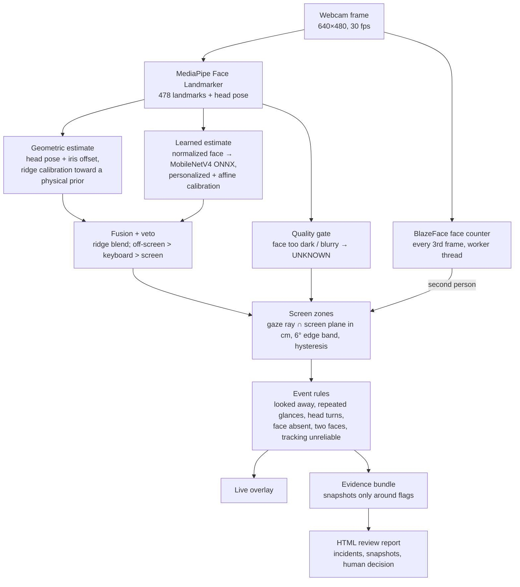

# Gaze-Track

[](https://github.com/iyush05/gaze-track/actions/workflows/tests.yml)


**Real-time, on-device gaze and attentiveness tracking for exam proctoring, from one laptop webcam.**
It tells whether an exam-taker is looking at the screen, its edges, the keyboard or away, turns that into
reviewable events (repeated glances, head turns, looking down), and never decides anything on its own: every flag
goes to a human reviewer with snapshots as evidence.

<!-- DEMO: record ~15 s of `run` (look at the screen, an edge, away, turn your head), save as docs/demo.gif,
     then replace this comment with:  -->

## Highlights

| | Result |
|---|---|
| Latency, full pipeline on a laptop CPU (Apple M2) | **9.2 ms median, 9.7 ms p95** per frame |
| Gaze error after calibration (held-out screen targets) | **1.9–2.5°** fused estimator (vs 2.9–3.2° geometric baseline) |
| Learned gaze model on unseen MPIIFaceGaze people | **5.08°**, 1.15 ms on CPU (ONNX Runtime) |
| Scripted cheating behaviours caught | **8 / 9** segments, first flag after 5–6.5 s |
| Honest behaviour falsely flagged | **0 / 9** segments; 0 flags in a 10-min honest session |
| Confidently-wrong output in very dark video | **64% → 2.2%** with image-quality gating |
| Evidence stored for a 4-min session | **432 KB** of snapshots instead of ~120 MB of video |

All numbers come from one test subject so far; see [Limitations](#limitations).

## How it works



1. **Geometric baseline.** Head pose and the iris position inside each eye are mapped to gaze angles by a per-user
   calibration (16 dots, ~35 s); the gaze ray is intersected with the screen plane to get a point in cm.
2. **Learned model.** A MobileNetV4-small trained on MPIIFaceGaze, optionally fine-tuned on the user's own
   recordings, predicts gaze from a normalized 112 px face crop.
3. **Fusion with a veto.** A per-user ridge blend of both estimates is more accurate on screen; whenever the
   geometric estimate says off-screen or keyboard, it wins (the blend under-reacts outside the screen).
4. **Zones → events.** Zones with spatial hysteresis feed temporal rules tuned on recorded honest and cheating
   behaviour (e.g. looking up to think needs 8 s, a head turn > 25° for 1.5 s is flagged).
5. **Safety and review.** Bad images produce `UNKNOWN`, not guesses; long `UNKNOWN` raises "tracking unreliable".
   `report` turns a session into an offline HTML page of incidents with snapshots and Confirm / Dismiss decisions.

## Quick start

Requires [uv](https://docs.astral.sh/uv/) and a webcam. On macOS, allow camera access for your terminal.

```bash
git clone https://github.com/iyush05/gaze-track && cd gaze-track
uv sync                                                    # Python 3.13 + dependencies
uv run python -m gaze_track download-models                # MediaPipe + released gaze model (SHA-256 verified)
uv run python -m gaze_track calibrate --profile me --model latest   # follow 16 dots (~35 s)
uv run python -m gaze_track run --profile me --evidence    # live overlay; q to quit
uv run python -m gaze_track report runs/evidence/<bundle>  # HTML review report
```

Defaults assume a MacBook Air 13.6" screen; for another display run `uv run python -m gaze_track config` and set
the screen size in cm in `config.json`.

## All commands

| Command | Purpose |
|---|---|
| `calibrate`, `run`, `bench`, `cameras` | Calibrate a user, track live (optionally with `--evidence`), measure latency, list cameras |
| `collect`, `collect-honest`, `collect-behavior` | Record labelled sessions: gaze targets, normal work, scripted honest/cheating behaviour |
| `eval [--fast] [--model … --fuse]` | Gaze error, zone F1, off-screen F1, false flags per hour, per-segment cheating detection |
| `report <session or bundle>` | Self-contained HTML review report |
| `robustness [--gate]` | Re-run the pipeline under 9 image degradations |
| `prepare-mpii`, `train`, `personalize`, `export-onnx`, `quantize-onnx` | Data preparation, training, personal fine-tuning, deployment exports |
| `download-models` | Fetch and verify model files |

## Evaluation

- **Gaze accuracy:** each guided session calibrates on its own 9 dots and is scored on 24 *other* dots at known
  positions (half near the edges), in degrees and cm.
- **Detection:** cued off-screen looks give off-screen precision/recall; scripted behaviour sessions (reading,
  typing, thinking vs notes beside the screen, phone in lap, asking someone) give per-segment detection.
- **False flags:** every warning in an honest work session is false by construction.
- **Robustness:** 9 deterministic degradations; everything (landmarks included) is recomputed from the degraded image.
  Very dark, blur and heavy JPEG hurt; overexposure, noise and 320×240 don't. The face is still detected in 100% of
  frames in every case, so failures are silent, which is why quality gating exists.

Design decisions and every measured result, including the experiments that didn't work (INT8 after personalization,
a bigger ResNet-18 backbone, RepViT, eye-region sharpness), are documented in [PLAN.md](PLAN.md).

## Limitations

- **One subject.** All own-data results come from one person; generalization across people, ages, skin tones and
  eye conditions is untested. The false-flag bound (0 in 10 min) is < 18/h at 95%, not yet the < 1/h target.
- Some behaviour thresholds were tuned on the sessions they are scored on.
- Notes placed right beside the screen are missed: those glances fall inside the range of honest gaze.
- `NEAR_OFF` vs `FAR_OFF` is unreliable for eye-only glances far outside the calibrated range.

## Privacy and responsible use

Everything runs locally; nothing is uploaded. Evidence mode keeps the last ~15 s of downscaled frames in memory and
writes snapshots only around flags. Flags are signals for human review, never automatic decisions. Real deployment
would need informed consent, a retention period, and an accommodation path for people the gaze model doesn't fit.

## Project layout

```
gaze_track/
  pipeline.py        per-frame pipeline: landmarks → gaze → zone → events, quality gate, fusion veto
  features.py        head pose, iris offsets, eye openness      geometry.py   angles, ray–plane intersection
  calibration.py     ridge toward a physical prior               fusion.py     fused estimator
  zones.py events.py zones with hysteresis, temporal rules        quality.py    luminance / sharpness gating
  learn/             GazeNet, training, ONNX export, INT8, inference
  data/              sessions, protocols, normalization, MPIIFaceGaze, behaviour protocol
  evaluate.py robustness.py report.py evidence.py collect.py download.py cli.py
tests/               74 tests (pytest)
```

## Licence and credits

Code: [MIT](LICENSE). Released model weights: CC BY-NC-SA 4.0, because they are trained on
[MPIIFaceGaze](https://www.perceptualui.org/research/datasets/MPIIFaceGaze/) (X. Zhang, Y. Sugano, M. Fritz,
A. Bulling, "It's Written All Over Your Face: Full-Face Appearance-Based Gaze Estimation", CVPR Workshops 2017);
see [MODEL_CARD.md](MODEL_CARD.md). Face landmarks and detection: Google MediaPipe. Data normalization follows
Zhang, Sugano and Bulling, "Revisiting Data Normalization for Appearance-Based Gaze Estimation", ETRA 2018.
